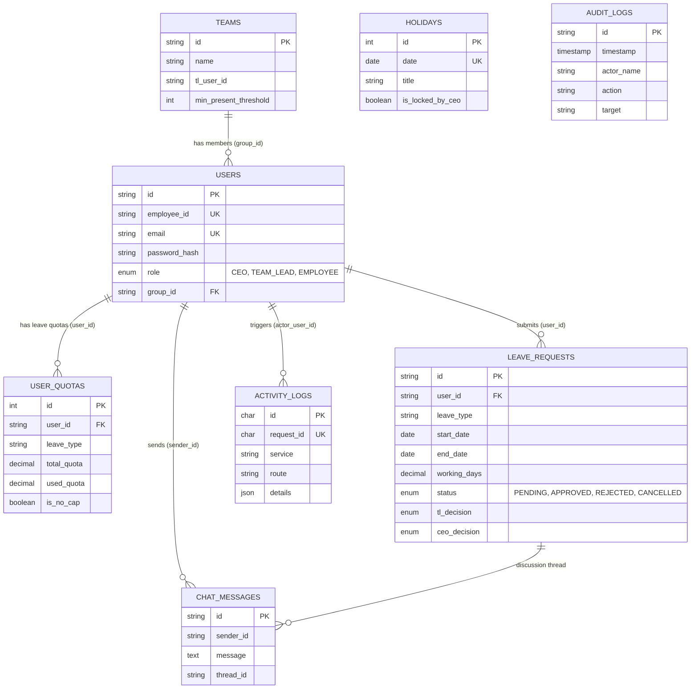

# LeaveDesk — Enterprise Leave Management System

LeaveDesk is a production-grade enterprise leave management solution featuring an **Android (Jetpack Compose)** mobile client powered by a **Node.js microservices backend** and a relational **MySQL 8.0+** database.

---

## 1. System Architecture & Database ER Diagram

The database (`leavedesk_db`) is designed with **8 relational tables** running on the **InnoDB** storage engine to guarantee full ACID compliance, foreign key cascade constraints, and row-level locking for concurrent balance deductions.



### Table Relationships & Integrity Rules
- **`users` ➔ `user_quotas`**: One-to-Many (`FOREIGN KEY (user_id) REFERENCES users(id) ON DELETE CASCADE`). If a user is deactivated/deleted, their balance records cascade automatically.
- **`users` ➔ `leave_requests`**: One-to-Many (`FOREIGN KEY (user_id) REFERENCES users(id) ON DELETE CASCADE`). Maintains request ownership.
- **`teams` ➔ `users`**: Team/Department structure (`users.group_id` links to `teams.id`).
- **Composite Unique Key (`uk_user_leave`)**: On `user_quotas(user_id, leave_type)`. Prevents duplicate quota records for the same employee and leave type.

---

## 2. Table & Column Breakdown (Storage & Schema Details)

| Table | Column | Type | Constraints | Description & Storage Logic |
|---|---|---|---|---|
| **`users`** | `id` | `VARCHAR(64)` | `PRIMARY KEY` | Unique ID (e.g., `u_emp1`, `u_ceo`). |
| | `employee_id` | `VARCHAR(32)` | `UNIQUE`, `NOT NULL` | Business identifier (e.g., `EMP101`, `TL201`, `CEO001`). |
| | `email` | `VARCHAR(128)` | `UNIQUE`, `NOT NULL` | Corporate email address. |
| | `password_hash`| `VARCHAR(255)` | `NOT NULL` | Bcrypt hashed secret (or verified plaintext fallback). |
| | `role` | `ENUM(...)` | `NOT NULL` | Strict role enforcement: `'CEO'`, `'TEAM_LEAD'`, `'EMPLOYEE'`. |
| | `group_id` | `VARCHAR(64)` | Index | Department identifier for TL approval scoping. |
| **`user_quotas`** | `user_id` | `VARCHAR(64)` | `FK -> users(id)` | Employee owning this balance. |
| | `leave_type` | `VARCHAR(16)` | `NOT NULL` | Code: `CL` (Casual), `SL` (Sick), `EL` (Earned), `WFH`, `LOP`. |
| | `total_quota` | `DECIMAL(5,1)`| Default `0.0` | Allocated allowance (e.g., `12.0`). |
| | `used_quota` | `DECIMAL(5,1)`| Default `0.0` | Utilized days (supports `0.5` half-day decrements). |
| | `is_no_cap` | `BOOLEAN` | Default `FALSE` | Set to `TRUE` for uncapped leaves (`WFH`, `LOP`). |
| **`leave_requests`**| `id` | `VARCHAR(64)` | `PRIMARY KEY` | Application ID (e.g., `LR-7892`). |
| | `start_date` / `end_date` | `DATE` | `NOT NULL` | Standard ISO date format (`YYYY-MM-DD`). |
| | `working_days`| `DECIMAL(5,1)`| `NOT NULL` | Deductible business days (excluding weekends/holidays). |
| | `status` | `ENUM(...)` | Default `'PENDING'`| State machine: `'PENDING'`, `'APPROVED'`, `'REJECTED'`, `'CANCELLED'`. |
| | `tl_decision` | `ENUM(...)` | `NULL` | `'APPROVED'`, `'REJECTED'`, `'QUERY'`. |
| | `ceo_decision`| `ENUM(...)` | `NULL` | `'APPROVED'`, `'REJECTED'`. |
| **`holidays`** | `date` | `DATE` | `PRIMARY KEY / UK` | Holiday or lock date. |
| | `is_locked_by_ceo` | `BOOLEAN` | Default `FALSE` | Prevents employees from selecting this date during leave application. |
| | `lock_reason` | `VARCHAR(255)` | `NULL` | Context for freeze (e.g., "Q4 Production Freeze"). |
| **`activity_logs`**| `request_id` | `CHAR(36)` | `UNIQUE` | Distributed trace UUID per HTTP request. |
| | `details` | `JSON` | `NOT NULL` | Native JSON telemetry (status, path, user agent, latency). |

---

## 3. Backend Implementation & Methods

The backend uses **Node.js** with **`mysql2/promise`** (`backend/mysql-db.js`) following production database design patterns:

### 1. Connection Pooling
Instead of creating a new TCP handshake per request, a pool maintains 10 reusable connections:
```javascript
this.pool = mysql.createPool({
  host: process.env.MYSQL_HOST || 'localhost',
  port: parseInt(process.env.MYSQL_PORT || '3306', 10),
  user: process.env.MYSQL_USER,
  password: process.env.MYSQL_PASSWORD,
  database: process.env.MYSQL_DATABASE,
  connectionLimit: 10,
  waitForConnections: true,
  queueLimit: 0
});
```

### 2. Parameterized Prepared Statements
All database operations use `?` placeholders. User inputs are never string-concatenated, completely blocking SQL injection attacks:
```javascript
const [rows] = await this.pool.query(
  `SELECT * FROM users WHERE LOWER(employee_id) = ? LIMIT 1`,
  [cleanIdentifier]
);
```

### 3. Automatic Migrations & Seeding
On server boot, `initMySQL()` verifies database existence, automatically executes `CREATE TABLE IF NOT EXISTS` for all 8 tables, and seeds initial roles and quota allowances.

### 4. Data Mapping
SQL relational `snake_case` fields are transformed into JavaScript and Android client `camelCase` DTOs:
```javascript
const [rows] = await this.pool.query(`
  SELECT leave_type as leaveType,
         total_quota as total,
         used_quota as used,
         is_no_cap as isNoCap
  FROM user_quotas WHERE user_id = ?
`, [userId]);
```

---

## 4. The "Keys" to Write on SQL (CRUD Operations)

Use these SQL query templates to execute writes or explain how the backend interacts with MySQL:

### A. Submitting a Leave Application (INSERT)
```sql
INSERT INTO leave_requests (
  id, user_id, user_name, user_role, group_id, group_name,
  leave_type, start_date, end_date, working_days, is_half_day,
  reason, backup_user_id, backup_user_name, status
) VALUES (
  'LR-9012', 'u_emp1', 'Alex Chen', 'EMPLOYEE', 'g_eng', 'Engineering & Product',
  'CL', '2026-11-20', '2026-11-21', 2.0, FALSE,
  'Family function', 'u_emp2', 'Sarah Jenkins', 'PENDING'
);
```

### B. Atomic Quota Deduction (UPDATE)
Prevents race conditions by modifying the balance in-place in the database engine:
```sql
UPDATE user_quotas 
SET used_quota = used_quota + ? 
WHERE user_id = ? 
  AND leave_type = ? 
  AND is_no_cap = FALSE;
```

### C. Quota Refund on Cancellation (UPDATE with `GREATEST`)
Safely refunds balance without allowing negative usage:
```sql
UPDATE user_quotas 
SET used_quota = GREATEST(0, used_quota - ?) 
WHERE user_id = ? 
  AND leave_type = ? 
  AND is_no_cap = FALSE;
```

### D. Multi-Tier Approval Decision (UPDATE)
Updates the decision state for Team Lead or CEO:
```sql
UPDATE leave_requests 
SET status = 'APPROVED', 
    tl_decision = 'APPROVED', 
    tl_comment = 'Covered by Sarah.' 
WHERE id = 'LR-9012';
```

### E. CEO Calendar Date Lock / Upsert (`ON DUPLICATE KEY UPDATE`)
Locks or unlocks a holiday date; creates the date if it doesn't already exist:
```sql
INSERT INTO holidays (date, title, is_locked_by_ceo, lock_reason)
VALUES ('2026-12-01', 'Q4 Release Freeze', TRUE, 'All-hands production deployment')
ON DUPLICATE KEY UPDATE 
  is_locked_by_ceo = VALUES(is_locked_by_ceo), 
  lock_reason = VALUES(lock_reason);
```

### F. Real-time Team Collaboration (INSERT)
Persists chat messages attached to leave discussions:
```sql
INSERT INTO chat_messages (id, sender_id, sender_name, sender_role, message, thread_id, related_request_id)
VALUES ('MSG-101', 'u_emp1', 'Alex Chen', 'EMPLOYEE', 'Can you cover my shift?', 'general', 'LR-9012');
```

---

## 5. Local Setup & Execution Guide

### Microservice Ports Layout
- **Gateway**: `http://localhost:8084` (Health: `http://localhost:8084/health`)
- **Auth Service**: `http://localhost:8081`
- **Workflow Service**: `http://localhost:8082`
- **Calendar & Chat Service**: `http://localhost:8083`

### 1. Start the Backend
1. Open terminal in `backend/`:
   ```bash
   cd backend
   npm install
   npm run db:verify   # Tests connection to MySQL & table counts
   npm start           # Starts gateway & microservices
   ```
2. Verify:
   ```bash
   curl http://localhost:8084/health
   # Response: {"status":"UP","services":{"mysql":"MYSQL_ONLINE",...}}
   ```

### 2. Demo Login Credentials
| Role | Employee ID | Password | Department |
|---|---|---|---|
| **CEO** | `CEO001` | `password123` | Executive Office |
| **Team Lead** | `TL201` | `password123` | Engineering & Product |
| **Employee** | `EMP101` | `password123` | Engineering & Product |

### 3. Connect Android App
- **Android Emulator**: Automatically routes to `http://10.0.2.2:8084/`.
- **Physical Device**: Set your local PC Wi-Fi IP in `build.gradle.kts` (e.g., `http://192.168.1.100:8084/`).
- Launch via **Android Studio** ➔ Run `app`.

---

## 6. How to Explain This Architecture in Reviews & Interviews

> *"We designed LeaveDesk's backend around MySQL 8.0 with InnoDB to guarantee ACID compliance for enterprise balance tracking. Our architecture features 8 relational tables cleanly separating Users, Department Teams, Quotas, Applications, and Audit Trails. Quotas leverage a composite unique key `(user_id, leave_type)` and atomic SQL increments to prevent double-spending race conditions. All database interactions run through a Node.js connection pool (`mysql2/promise`) using strictly parameterized prepared statements to eliminate SQL injection vulnerabilities."*